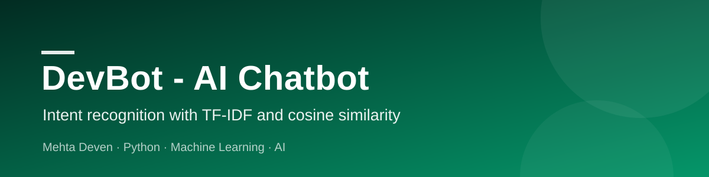
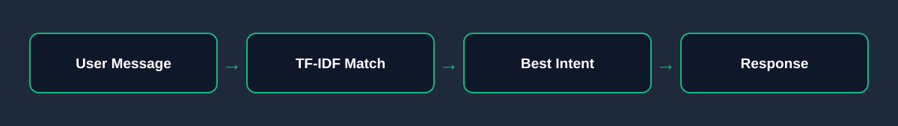

# DevBot — AI Chatbot in Python

  

A conversational bot that matches **intent**, not keywords. DevBot answers questions about Deven's projects, Python, and machine learning — and, by design, honestly says *"I didn't quite get that"* when a question is outside what it knows.

## Conversation sample

```
You:    what projects have you built?
DevBot: Deven has built: a Digit Recognizer (98.9% accuracy), a Spam SMS
        Classifier, a Movie Recommender, this chatbot, and a Text Summarizer.

You:    what is machine learning?
DevBot: Machine Learning is teaching computers to find patterns in data
        instead of hand-writing every rule...

You:    tell me a joke about quantum physics
DevBot: I didn't quite get that. Try asking about Deven's projects...
```

## How it works



1. `intents.json` defines topics with example phrasings and responses
2. TF-IDF (with English stop-words removed) vectorises every example
3. The user's message is vectorised identically; cosine similarity selects the closest intent
4. Below a 0.3 similarity threshold, the fallback response is returned instead of a guess

That threshold is a deliberate engineering choice: an earlier version without stop-word removal confidently answered a quantum-physics joke with Deven's biography. The fix — and the reasoning — is documented in the code.

## Quick start

```bash
pip install -r requirements.txt
python chatbot.py   # interactive chat (type 'bye' to exit)
python demo.py      # scripted demonstration
```

New topics need no code: add an intent to `intents.json` and restart.

## What this project demonstrates

- Intent classification, the core of support and FAQ bots
- Similarity thresholds and honest fallback design
- Data-driven behaviour: the bot's knowledge lives in JSON, not code

## Roadmap

- Logistic Regression intent classifier
- Streamlit web interface
- Optional LLM API for open-ended questions

---

**Author:** [Mehta Deven](https://github.com/mehtadeven) — IT student at SAL College of Engineering, Ahmedabad, building a public portfolio in Python, Machine Learning and AI.
**Portfolio:** [mehtadeven.github.io/portfolio](https://mehtadeven.github.io/portfolio/)

