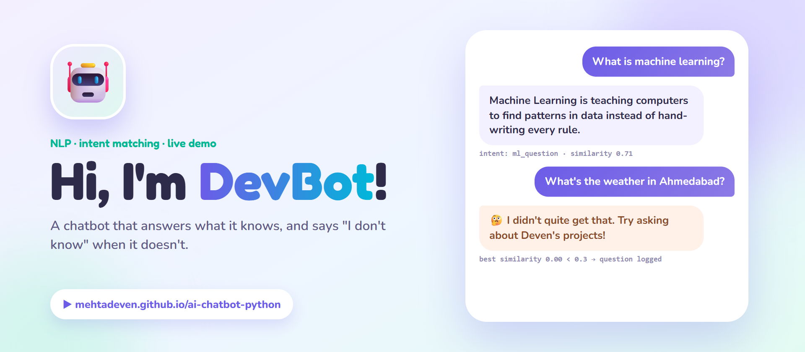
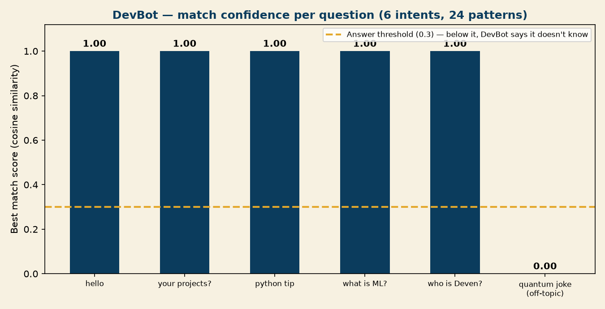
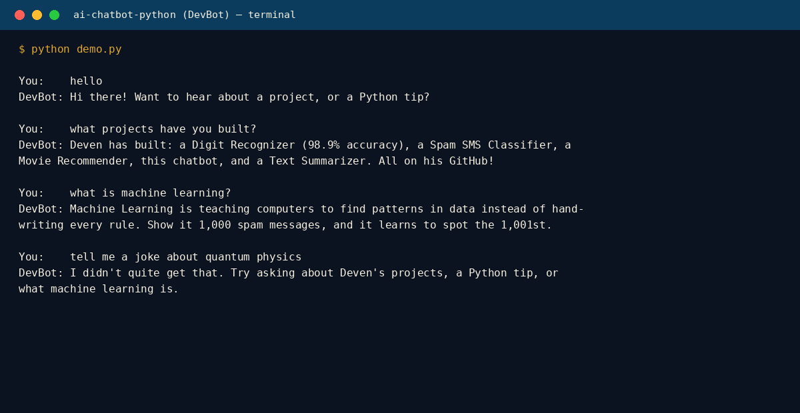
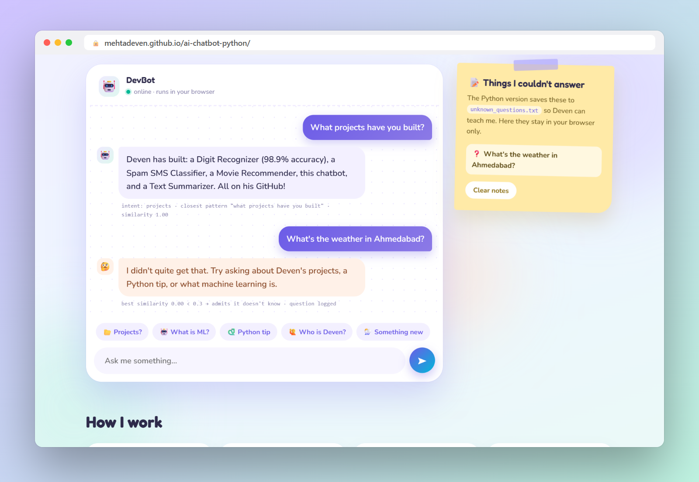

[](https://mehtadeven.github.io/ai-chatbot-python/)

# DevBot — AI Chatbot in Python

[](https://mehtadeven.github.io/ai-chatbot-python/)    [](LICENSE) 

<p align="center">
  <a href="https://mehtadeven.github.io/ai-chatbot-python/"><b>▶ Try the live demo</b></a> &nbsp;·&nbsp;
  <a href="#how-it-works">How it works</a> &nbsp;·&nbsp;
  <a href="https://mehtadeven.github.io/">Portfolio</a>
</p>

A conversational bot that matches **intent**, not keywords. DevBot answers questions about Deven's projects, Python, and machine learning — and, by design, honestly says *"I didn't quite get that"* when a question is outside what it knows.

## Who this helps

- **Beginners learning how chatbots work** — DevBot matches intent with TF-IDF instead of keyword if-else chains, and the code stays small enough to follow.
- **Students building college projects** — intents, patterns and responses live in one JSON file, so you can retrain the bot on your own topic by editing data, not code.
- **Anyone wary of chatbots that bluff** — below a confidence threshold DevBot honestly says it does not know, and logs the question so the owner can teach it later.
- **NLP learners** — the match-confidence chart in Results makes the idea of a similarity threshold concrete.

## Conversation sample

```
You:    what projects have you built?
DevBot: Deven has built: a Digit Recognizer (98.9% accuracy), a Spam SMS
        Classifier, a Movie Recommender, this chatbot, and a Text Summarizer.

You:    what is machine learning?
DevBot: Machine Learning is teaching computers to find patterns in data
        instead of hand-writing every rule...

You:    tell me a joke about quantum physics
DevBot: I didn't quite get that. Try asking about Deven's projects...
```

## Results



*Generated by `generate_charts.py`, which runs DevBot's real matcher. Questions taken from the bot's own example patterns match at 1.00; the off-topic quantum-physics joke scores 0.00 — below the 0.3 threshold — and gets the honest fallback. The bot currently knows 6 intents, 24 example patterns and 9 responses (run `python stats.py` for the full breakdown).*

## Demo



*Real run of `python demo.py` — a scripted DevBot conversation, including the honest fallback for an off-topic question.*

## Live demo

[](https://mehtadeven.github.io/ai-chatbot-python/)

**Design:** a *friendly pastel chat* theme — lavender-to-mint gradients, rounded Fredoka + Nunito type, a phone-style chat window and sticky notes for the questions DevBot couldn't answer.

**[mehtadeven.github.io/ai-chatbot-python](https://mehtadeven.github.io/ai-chatbot-python/)** — chat with DevBot in your browser. Each reply shows the matched intent, the closest pattern and its similarity score, and questions it can't answer appear in a side panel (stored only in your browser, like `unknown_questions.txt` in the Python version).

The browser bot in [`web/`](web/) reads the same `intents.json` through `web/devbot-data.js`, generated by `gen_web_data.py` — rerun it after editing the intents. Every push to `main` redeploys the demo through [`.github/workflows/pages.yml`](.github/workflows/pages.yml).

## How it works


1. `intents.json` defines topics with example phrasings and responses
2. TF-IDF (with English stop-words removed) vectorises every example
3. The user's message is vectorised identically; cosine similarity selects the closest intent
4. Below a 0.3 similarity threshold, the fallback response is returned instead of a guess

That threshold is a deliberate engineering choice: an earlier version without stop-word removal confidently answered a quantum-physics joke with Deven's biography. The fix — and the reasoning — is documented in the code.

## Download & run (2 minutes)

**Step 1 — Download the code**

```bash
git clone https://github.com/mehtadeven/ai-chatbot-python.git
cd ai-chatbot-python
```

No Git? On the GitHub page for this repo, click the green **Code** button, choose **Download ZIP**, unzip it, and open that folder in a terminal.

**Step 2 — Install what it needs** (Python 3.10 or newer)

```bash
pip install -r requirements.txt
```

**Step 3 — Run it**

```bash
python demo.py      # scripted demonstration (no typing needed)
python chatbot.py   # interactive chat — type 'bye' to exit
python stats.py     # how many intents, patterns and responses the bot knows
```

**Step 4 — What you should see**

You should see DevBot answer the project and machine-learning questions, and honestly say it did not get the quantum-physics joke — like the demo image above.

## The unknown-question log

Every question the bot cannot answer is appended to `unknown_questions.txt`
(one question per line, created automatically on first use). It is a to-do
list for teaching the bot: read it, spot repeated questions, and add an
intent for them in `intents.json`. The file is git-ignored, since it holds
real conversations.

## Run the tests

```bash
pip install pytest
python -m pytest
```

The tests check that known questions get real answers, off-topic questions
get the honest fallback, unknown questions are logged, and every intent in
`intents.json` is well-formed.

## What this project demonstrates

- Intent classification, the core of support and FAQ bots
- Similarity thresholds and honest fallback design
- Data-driven behaviour: the bot's knowledge lives in JSON, not code

## Roadmap

- Logistic Regression intent classifier
- Streamlit web interface
- Optional LLM API for open-ended questions

## Need help?

- **`pip` not found?** Use `python -m pip install -r requirements.txt` instead — it does the same thing.
- **Wrong folder error (file not found)?** Check your terminal is inside the repo folder — the prompt should end with the repo name, and `ls` (Mac/Linux) or `dir` (Windows) should list `README.md`.
- **Still stuck?** Open an Issue on this repo on GitHub with the command you ran and the full error message — that is the fastest way to get help.

## Contributing

Contributions are welcome — see [CONTRIBUTING.md](CONTRIBUTING.md) for
setup, how to run the tests, and how to add a new intent.

## Licence

MIT — see [LICENSE](LICENSE).

---

**Author:** [Mehta Deven](https://github.com/mehtadeven) — IT student at SAL College of Engineering, Ahmedabad, building a public portfolio in Python, Machine Learning and AI.
**Portfolio:** [mehtadeven.github.io/portfolio](https://mehtadeven.github.io/portfolio/)

